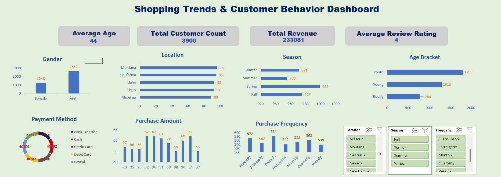

# Shopping Trends & Customer Behavior Dashboard

## About
An Excel dashboard that analyses shopping trends and customer behavior.

## Key Numbers
- Average age: 44
- Total customers: 3,900
- Total revenue: 233,081
- Average review rating: 4

## What the Dashboard Shows
- Customers by gender
- Top locations
- Purchases by season
- Customers by age bracket
- Payment methods
- Purchase amount
- Purchase frequency
- Slicers to filter by location, season and frequency

## Tools Used
Excel: Pivot Tables, Pivot Charts, Slicers

## File
Excel project dataset july (1).xlsx
